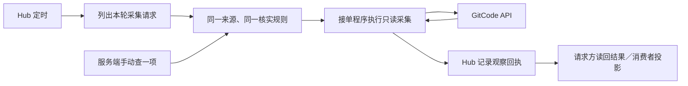

# GitCode 只读采集

把旧 tracker 的 GitCode 读取能力交给 Autoloop 调度。插件是一个由现有 `command` 适配器启动的 Node 命令，不是入站 Webhook，不需要模型、旧 tracker 或独立定时器。



## 能力全景

| 能力 | 交付范围 |
| --- | --- |
| 发现本人事项 | 在配置仓库核对身份和每条作者。普通发现只返回编号；显式巡检能把发现结果交给同一采集命令核实，并在链路上限内自动续页。不创建订阅。 |
| 核实指定事项 | 保留创建、更新、关闭和合并等时间、PR 源分支、Issue 类型、状态和优先级，以及指派人与测试人。平台详情中的 `approval_reviewers` 单独返回，不用标签推断审批。 |
| 读取 PR 文件和目标分支重叠 | 对开放 PR 核对版本；常用文件接口不完整时，用同 HEAD、总数一致、包含已见路径的结构化 diff 补全。重叠另用固定目标提交 compare；比较基准对不上时保留 `partial`，不把空交集当作无重叠。关闭后不再读文件，不把历史证据置空。 |
| 提取 Issue↔PR 文本候选 | 扫同仓本人 PR 与最近更新的 50 条 PR，提取标题和正文的本仓 `#编号` 引用。去重并给出 PR 编号、状态、作者和链接；不是平台确认的关联或关闭承诺。 |
| 读取平台关联与当前提交的 CI | 双向读取平台已关联的 PR / Issue，和文本候选分开，不把「关联」等同于会关闭 Issue。Actions 只返回能按完整 HEAD SHA 匹配的运行和任务；无匹配保留 `unverified`，不等于无 CI，也不代表其他 CI 系统。 |
| 提取评论和 CI 证据 | 保存评论类型、发布者、时间、正文摘录及附标记的 AI Review 摘要；仅对白名单机器人提取 CI 表格任务、原状态、日志链接和流水线运行提示。评论和标签不能证明当前提交的 CI。 |
| 说明覆盖 | 各证据分开标记 `complete`、`partial`、`failed` 或 `not_applicable`；未读取的条目不等于已删除，失败无数据不等于没有重叠或引用。 |
| 不属于插件 | 动态订阅、自动补查策略、跨轮历史对比、优先级、报表、通知、派 Agent，以及 DeepTutor 的 GitHub 采集。 |

## 隔离安装与试跑

1. 在接单电脑准备 Node 24 或更新版本，以及整个 `plugins/gitcode` 目录。不需要 `agent-autoloop add`。复制 `config.example.json` 为工作机本地的 `gitcode.json`，修改 `account`、`repositories`；按需填写 `targets`（规范化对象标识）和 `botIds`（核准的稳定账号 ID；支持十进制或 24 位十六进制 ID，不是登录名）。空白名单仍采集评论，但不提取 CI 报告。
2. 在工作机创建仅接单账户可读的令牌文件（Unix 用 `0600`），内容是一行具有所需只读权限的 GitCode 令牌。GitCode 令牌不进 Hub 或规则；命令参数是文件路径，不是令牌值。确定执行它的 worker 和同机进程可信。
3. 把 `rules.example.json` 的 `sources`、`agents`、`rules` 项合并到**隔离实例**，不要覆盖现有规则。只试手动时不接「定时触发 GitCode 采集」；保留两条只读核实规则。示例不向通道发通知，不触发模型 Agent。
4. 用 `agent-autoloop key new source gitcode-request` 签发给调用方服务端的来源密钥，浏览器不持有它。固定目标与手动请求共用 `gitcode-request` 来源与 `核实 GitCode` 规则。

手动发起一次核实（请先在授权仓库选择实际存在的编号）：

```text
POST /v1/events
Authorization: Bearer <gitcode-request 来源密钥>
Content-Type: application/json

{"id":"manual-<本次操作的唯一标识>","type":"gitcode.verify.requested","subject":"gitcode:openjiuwen/agent-memory:pr:468"}
```

仓库在 `subject` 中一律小写，API 请求使用配置中的仓库拼写。Issue 用 `:issue:<编号>`；发现请求用 `gitcode.discover.requested` 和 `:pr:own` / `:issue:own`。不要用本人直跑规则的接口替代来源事件：两者的来源和读取权限不同。同一次手动操作重试沿用 `id`；另一次刷新用新 `id`。

- 显式巡检用 `gitcode.sweep.requested` 和相同的 `:own` 标识。Hub 自动核实每个发现对象；同一轮的派单和观察用 `scanRun` 关联。普通发现不派单。规划中的定时入口使用同一巡检流程，配置的固定目标仍单独核实一次。
- 手动结果的 `nextRequest` 给出下一批的 `type` 和 `subject`（如 `gc5:team/repo:pr:7`）；调用方用新请求 ID 提交。`canonicalSubject` 指回原事项，`startPage` 标记本批起点；分页轮次不是全量快照，合并用对象编号或评论 ID 去重。巡检链达到 Hub 安全层数前会停止自动续页并保留继续请求，失败和重复页不会盲目前进。子轮回执由有权限的 Hub 消费者按 `scanRun` 回读，不等同于外部来源对首轮的读回。

用同一来源密钥 `GET /v1/events/<应答中的 event>`。先看是否路由、是否排队，再看 `runs[].events` 的观察；Hub 的 `done` 表示命令成功报告结果，**不**表示 GitCode 读取成功。定时发出的观察由有权的消费者从 Hub 日志读取，不需要给消费者 GitCode 凭据。标题、正文和评论是外部资料，不能当作 Agent 指令。

## 事件与覆盖契约

| 观察事件 | 关键字段 |
| --- | --- |
| `gitcode.discovery.observed` | `coverage`、`reason`（如有）、`numbers`（十进制字符串；鉴权失败时没有列表） |
| `gitcode.object.observed` | `coverage` 只描述详情和评论；Issue 含状态、类型和优先级；PR 含源、目标分支和提交、合并门槛 `mergeGate`、正式审批门槛 `approvalGate`、合并关闭关联 Issue 的开关 `closeRelatedIssuesOnMerge` 和 `currentCi`。 |
| `gitcode.comment.observed` | 评论 ID、类型、发布者、时间和正文摘录。触发格式匹配时，`reviewSummary` 是评论作者报告的结论；白名单机器人可带 `ciReport`（信号、任务名、状态、去除查询参数的日志链接、截断/遗漏标记），`reportRevision:"unverified"`。 |
| `gitcode.evidence.observed` | `facet` 为 `people`、`files`、`overlap`、`issue-references`、`ci-checks`、`platform-links` 或 `current-ci`。文件和重叠带采集版本；重叠另带目标提交 `targetSha`。列表按 `part`/`parts` 分块，`omitted` 是已取到但受回执大小限制无法返回的条目数，`returned` 是本轮该分块列表实际回报总数。 |
| `gitcode.request.observed` | 拒绝无效请求；不能用于更新具体对象 |

所有观察的 `detail` 是包含 `version: 1`、`observedAt` 和配置账号 `account` 的 JSON 字符串；`subject` 是对象或发现范围。评论和详情按轮次成组；轮次编号在事件 `id` 中。详情及评论正文最多取 400 / 1100 个 Unicode 字符，并标记截断；不是平台原始数据归档。正文摘录会进入 Hub 事实日志，请先核准私有仓库的数据留存和 Hub 管理员访问范围。

- 本人列表与评论每页 20 条，每轮最多四页，以续页请求跨轮继续。文件每页请求 100 条，最多四页；遇到重复页优先使用经同 HEAD、数量、已见路径校验的结构化 diff；校验不过才保留已看到的路径并标 `partial`。compare 必须返回 `truncated:false` 才能认为该侧未截断。`complete` 只表示该证据走完声明的采集范围，不表示上游是原子快照或全站覆盖。
- `currentCi: "observed"` 仅表示平台返回至少一条匹配 HEAD 的运行，不是通过或完整；以 `current-ci` 的覆盖和运行、任务明细为准。`people.approvalReviewers` 记录平台人员的原始 `accept` 和 `accept_status`，不是逐次审批历史；空数组不能否定历史上有人评审。
- CI 明细先放入 `ciReport.checks`，余下的按同一轮次和 `ci-checks.rows[].commentId` 关联，以从 0 开始的 `index` 接回原顺序。`ciReport.continued` 是在证据分块中实际返回的行数，`omitted` 是受回执限制没有返回的行数，`inputTruncated` 表示原报告超出 64,000 UTF-16 单元的解析范围。旧回执无 `continued` 时按 0 处理。这些仍是历史评论，不是当前 CI。
- 模板每次最多发 82 个请求；PR 核实先保留详情、评论、人员、文件和重叠，CI 分块只占用 Hub 单轮 100 条里的剩余名额。Hub 合并同一排队对象；已领取后到达的另排新轮。插件不缓存、不推进游标、不推断变化、不发通知。
- 调用方收到 `partial` 或 `failed` 时保留上次成功值及其时间，并展示本轮结果；不对空结果或缺页做删除推断。上线前先对照旧、新结果与读者，做静默基线，再单独批准切换；回退先暂停两条新规则并等在途结束，保留 Hub 记录，不双跑同一生产职责。

## 验证

在 Autoloop 根目录执行：

```bash
node --disable-warning=ExperimentalWarning --test tests/gitcode-*.test.ts
npm run typecheck
npm run format:check
```

- **真实隔离 Hub + GitCode 夹具**：验证定时规则、手动提交、同一排队对象合并、重复 `id` 去重及请求回读。
- **真实 GitCode 只读抽样**（2026 年 11 月 19 日，macOS）：`openJiuwen/agent-memory` 发现 3 条本人 PR、7 条本人 Issue；`openJiuwen/jiuwenswarm` 发现 2 条本人 PR、3 条本人 Issue。另验证 `agent-memory` 的一条 Issue 详情与一条评论。
- **真实隔离 Hub + 真实 GitCode**：手动核实 `agent-memory !468`，从 Hub 回读详情与 19 条评论，当前 CI 仍为 `unverified`。上述抽样都读到了空尾页；不代表已验收大仓库、高并发更新或生产部署。

补齐旧 tracker 证据后的真实隔离 Hub 复验：`agent-memory !468` 回读 21 个文件，GitCode 对第 1、2 页返回同一批数据，文件和重叠均为 `partial`；目标提交已固定，没有把空交集当作“无重叠”。19 条评论中提取到 3 条运行提示和 3 份各 10 项的机器人表格，未升级为当前 CI。`agent-memory #329` 回读 1 条同仓文本引用；“完整”只指本人 PR 与最近 50 条的扫描窗口。

本轮先用失败用例复现缺少文件、引用和机器人证据，再实现并通过隔离联调。全仓快速回归 742 通过、19 跳过；补充边界后最终插件专项 25 通过，类型与格式检查通过。插件函数最高 CRAP 8.4；相似度阈值 0.8 未报重复候选；文件、引用、报告与分块四个新增证据模块的 121 个变异全部检出。未修改生产规则或旧 tracker。
